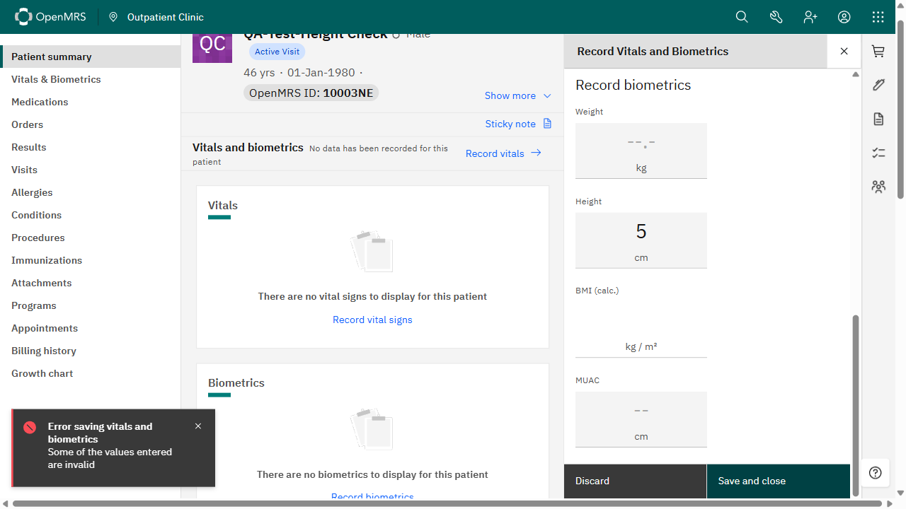

# Defect reports

Found while exploring and automating the **Record Vitals and Biometrics** form.

**Environment:** OpenMRS 3 public demo (o3.openmrs.org) · Chromium (Playwright 1.64) · user `admin` · tested 2026-10-21
**Test data:** temporary `QA-Test-` patients with an active visit, voided after each check.

| ID | Title | Severity |
|---|---|---|
| DEF-01 | Temperature above the system's own absolute limit is accepted and stored | High |
| DEF-02 | Out-of-range height shows only a generic error, no field message | Medium |
| DEF-03 | High (non-critical) values are flagged as critically high | Medium |

---

## DEF-01: Temperature above the system's own absolute limit is accepted and stored

**Severity:** High (data integrity in a clinical record)

**Steps**
1. Open a patient with an active visit and click **Record vitals**.
2. Enter Temperature **45**.
3. Click **Save and close**.

**Expected:** The value is rejected. The temperature concept on the server defines the absolute range as **25–43 °C**.

**Actual:** The form treats 45 as valid (its own limit is 25–47). The server accepts the encounter (HTTP 201) and the patient record now holds a temperature of **45**.

**Evidence:** `GET /concept/5088AAAAAAAAAAAAAAAAAAAAAAAAAAAAAAAA` returns `hiAbsolute: 43`. After saving, `GET /obs?patient=<uuid>&concept=5088AAAA…` returns the value `45`.

**Note:** The form and the server disagree on the limits, and neither rejects the value.

---

## DEF-02: Out-of-range height shows only a generic error, no field message

**Severity:** Medium (usability, inconsistent validation)

**Steps**
1. Open a patient with an active visit and click **Record vitals**.
2. Enter Height **5** (also reproduced with **300**).
3. Click **Save and close**.

**Expected:** A message under the Height field with the allowed range, as Temperature and SpO2 show (e.g. "Value must be between 25 and 47").

**Actual:** No message under the field. The form sends the data, the server rejects it, and only a generic pop-up appears: *"Error saving vitals and biometrics. Some of the values entered are invalid."* Nothing is saved.

**Impact:** With several fields filled in, the user is not told which value is wrong or what range is allowed.

---

## DEF-03: High (non-critical) values are flagged as critically high

**Severity:** Medium (misleading clinical alert)

**Steps**
1. Open a patient with an active visit and click **Record vitals**.
2. Enter each Pulse value below and leave the field.

**Expected:** A "high" marker (↑) for values between normal and critical, matching the "low" marker (↓) on the low side.

**Actual:** The low side is graded correctly, but the high side jumps straight to critical:

| Pulse | Range (server concept) | Marker shown | Correct |
|---|---|---|---|
| 40 | critically low (< 49) | ↓↓ critically low | Yes |
| 52 | low (< 55) | ↓ low | Yes |
| 72 | normal (55–100) | none | Yes |
| **110** | **high (100–130)** | **↑↑ critically high** | **No** |
| 140 | critically high (> 130) | ↑↑ critically high | Yes |

**Impact:** False critical alerts can cause over-reaction, or lead staff to ignore real ones.

**Related accessibility note:** Every marker has the same tooltip, "Abnormal value", so screen reader users cannot tell low, high and critical apart.
